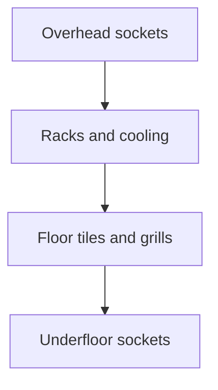

# Floorplan View and Editor

The hierarchy page already calls itself a raised-floor tile map, but [src/app/(dashboard)/hierarchy/page.tsx](src/app/(dashboard)/hierarchy/page.tsx) ignores the coordinates and stacks rack cards in a CSS grid. The database already stores the layout: a room is `gridCols` × `gridRows` of 600 mm tiles, racks sit at `Rack.posX/posY`, cooling units at `CoolingUnit.posX/posY`, floor whips at `PowerCircuit.posX/posY`, and a row is an anchor plus orientation (`Row.gridX/gridY`, `HORIZONTAL` or `VERTICAL`). Seeded Data Hall 1A uses this: Row A racks are at (3,3), (5,3), (7,3) and the perimeter CRAHs are at the edges.

## Layers

The same tile coordinate can hold something on each plane. A whip under the raised floor, a grill in the floor, a rack standing on it, and an overhead busway are four different objects.

Add two fields in [prisma/schema.prisma](prisma/schema.prisma):

- `PowerCircuit.elevation`: `UNDERFLOOR` or `OVERHEAD`, default `UNDERFLOOR`. Existing whips stay under the floor.
- `FloorTile`: `roomId`, `posX`, `posY`, `surface` (`SOLID` or `GRILL`), unique on room and tile. A missing row means a solid tile, so the seed does not need a tile per cell.

[src/components/floor/FloorPlan.tsx](src/components/floor/FloorPlan.tsx) switches the 2D plan between four layers. The other planes stay as a light ghost so alignment is obvious.

- **Underfloor** shows whips with `elevation = UNDERFLOOR`.
- **Floor** shows every raised-floor tile. A grill is drawn as a slatted tile; everything else is solid. Grills are allowed under a rack, in an aisle, or on an empty tile.
- **Rack** shows racks, row anchors, and cooling units, colored by the existing power, U-space, or A/B heatmap. Clicking a rack still opens `/racks/[id]`.
- **Overhead** shows whips with `elevation = OVERHEAD`.

Cooling units stand on the rack plane and cannot share a tile with a rack. Two sockets collide only when they share both the tile and the elevation. A grill never blocks a rack or a socket.

## Editor

An **Edit layout** toggle, shown only when `currentUserRole === "ADMIN"`. Standard users keep the read-only plan.

- Drag only affects the active layer. A rack or cooling unit can drop on a tile that already holds a socket or a grill. A socket can drop on a rack tile, a grill, or a socket of the other elevation. Two racks, a rack and a cooling unit, or two sockets of the same elevation cannot share a tile. Drops outside the grid are rejected. Pointer events, no new drag library.
- On the Floor layer, clicking a tile toggles it between solid and grill. That is the airflow control; it does not simulate flow.
- On Underfloor or Overhead, an edit control moves a socket to the other elevation.
- Dragging a row label moves that row’s anchor and every rack in the row by the same delta. The move is rejected if any rack would leave the grid or land on another rack-plane object. Sockets and grills on those tiles stay put.
- A small room-size control updates `gridCols` and `gridRows`, refusing a size that would clip an existing object.

## API

Add one admin action to [src/app/api/hierarchy/route.ts](src/app/api/hierarchy/route.ts), next to the existing create handlers:

- `MOVE_ON_FLOOR` with `{ kind: "RACK" | "COOLING_UNIT" | "FLOOR_SOCKET" | "ROW", id, posX, posY, elevation? }`.
- The server checks the object belongs to the room and the tile is inside the grid. Occupancy is per plane: rack and cooling unit against other rack-plane objects, socket against sockets with the same elevation. `elevation` is `UNDERFLOOR` or `OVERHEAD` and is only accepted for a floor socket.
- `SET_FLOOR_TILE` with `{ roomId, posX, posY, surface: "SOLID" | "GRILL" }`. Solid deletes the `FloorTile` row. Grill upserts it. A grill does not count as occupancy for racks or sockets.
- A row move applies one delta to `Row.gridX/gridY` and each member `Rack.posX/posY` in a transaction, ignoring sockets and grills.
- `RESIZE_ROOM` with `{ roomId, gridCols, gridRows }` refuses a size that would clip any object or grill.
- Write an audit row for each action. Standard callers already get 403 from `requireAdmin`.

Creation of sites, rooms, racks, CRAHs, and whips stays on the existing forms. New whips stay `UNDERFLOOR` until an admin moves them overhead.

## 3D view

A **2D / 3D** switch beside the layer control opens [src/components/floor/FloorPlan3D.tsx](src/components/floor/FloorPlan3D.tsx). Editing stays on the 2D grid. The 3D view reads the same coordinates and shows the whole stack at once:

- Floor at y = 0, one 0.6 m square per tile. Solid tiles are a dark slab. Grill tiles are a slatted mesh.
- Racks stand on the floor. Height comes from `totalU` at 44.45 mm per U, tinted with the active heatmap. Cooling units are shorter boxes on their tiles.
- Underfloor sockets sit just below the slab. Overhead sockets sit just above the tallest rack on that tile, or at a fixed busway height when the tile has no rack.
- Orbit controls, a simple light, and the room bounds from `gridCols` × `gridRows`. The active 2D layer is drawn solid and the other three are dimmed, so the switch still isolates a plane.

Dependencies added to the app image: `three`, `@react-three/fiber`, and `@react-three/drei`. The canvas is loaded with `next/dynamic` and `ssr: false`.

## Out of scope

Walls, doors, containment polygons, multi-tile footprints, freeform millimetre placement, airflow simulation, and dragging objects inside the 3D view. The electrical diagram page is unchanged.
