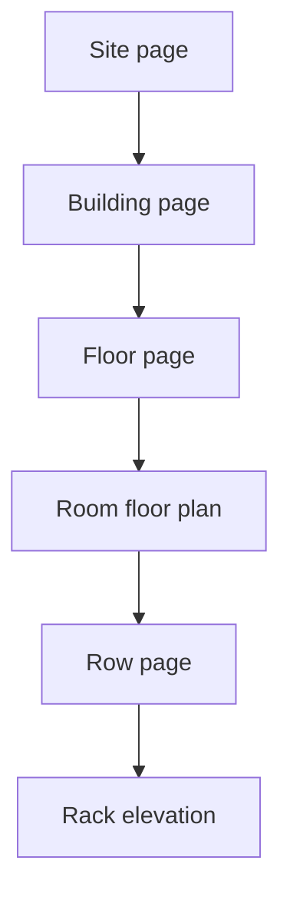

# Location pages for every tree level

Rooms already open the floor plan at `/hierarchy?room=`, and racks open `/racks/[id]`. Site, building, floor, and row names in [src/components/layout/LocationTree.tsx](src/components/layout/LocationTree.tsx) only expand. Clicking the name will open a page for that node. Chevrons and the `+ Bldg` / `+ Floor` / `+ Room` / `+ Rack` actions stay as they are, so the lifecycle test’s text-and-parent lookups still find them.

The Floor tab stays current on these pages as well as on `/hierarchy`, because they are the spatial hierarchy. The Rack tab stays current only on `/racks`. [src/components/layout/AppShell.tsx](src/components/layout/AppShell.tsx) and `ancestorIds` in [src/components/layout/infrastructure-context.tsx](src/components/layout/infrastructure-context.tsx) learn the new paths so the open node is highlighted and its parents are expanded.

No new schema and no second fetch. The pages read the infrastructure snapshot already loaded for the tree. Rollups come from rack metrics plus each room’s cooling units. `powerSources` is already in that response and will be kept on the provider so a site can list its supplies. Rooms have no position on a floor, so a floor is a directory of rooms, not a second floor plan.

Every page uses one frame: a breadcrumb whose segments link up the tree, then the same capacity figures (racks, used/total U, IT kW, online cooling kW).

## Row — `/rows/[rowId]`

A row is one line of racks. Show containment (cold aisle, hot aisle, or none), orientation, and the anchor tile, with a link back to that room’s floor plan. Under that, the racks in tile order as cards: code, U bar, power percent, A/B feed watts, and SPOF count. A card opens the rack elevation. An empty row says it has no racks yet.

## Floor — `/floors/[floorId]`

A level is the rooms on it. The header shows the level number and name. Room cards show type (data hall, power room, cooling plant, meet-me), rack count, U bar, IT kW against online cooling, and whether N+1 still holds. A card opens that room’s floor plan. Data halls are listed before the other room types.

## Building — `/buildings/[buildingId]`

A building is its floors stacked with the highest level number on top. Each band shows the level name and its rooms as compact chips (name, IT kW, rack count) that open the floor page or, from a chip, the room. The building has no address of its own; the breadcrumb carries the site.

## Site — `/sites/[siteId]`

A site is the campus. Show code, address, city, and country, then utility capacity against IT load and the PUE target. Building cards open the building page and show floor count, room count, IT kW, and U. Below that, the site’s power sources: type, A/B group, status, capacity, and load. Measured PUE is not stored, so the page shows the target only.

## Edit

Nothing after creation can be changed. [src/app/api/hierarchy/route.ts](src/app/api/hierarchy/route.ts) only creates these records, and the add dialog never asks for address, level number, or aisle containment. Each location page gets an **Edit** button in its header, visible to admins only, including the existing room floor plan and the rack elevation. It opens the same dialog, filled with the current values, and posts an update for that one record. Standard users keep the read-only pages.

The button saves the fields that page is about:

- Site: name, code, address, city, country, utility capacity, PUE target
- Building: name, code
- Floor: name, level number
- Room: name, code, room type, cooling capacity, redundancy, target temperature. Grid size stays on the floor plan’s Edit layout control.
- Row: name, orientation, aisle containment. Its tile stays where the floor plan drag left it.
- Rack: name, code, total U, max power, max weight. Its tile stays on the floor plan.

A duplicate site code returns an error in the dialog and leaves the record unchanged. Each save writes an audit row, then refreshes the shared snapshot so the tree and the page show the new values. There is no delete on these pages.
