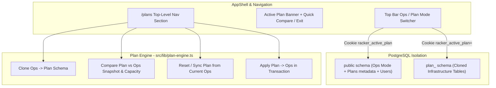

# Ops Mode and Plan Mode Architecture

## Overview

Racker will support two operating modes:
- **Ops Mode (Default)**: Production source of truth (`public` schema). Standard RBAC applies (Standard users edit in-rack gear; Admins edit facility, power, cooling, and system settings).
- **Plan Mode**: Users can create named plans cloned from live Ops, activate a plan, and make isolated changes (sites, rooms, floor plans, racks, appliances, PDUs, power chain, cooling) that are only visible to users who have that plan activated. Any authenticated user can create plans and edit all infrastructure layers inside an active plan (`effectiveRole = "ADMIN"` while in Plan Mode), while **Apply to Ops** is restricted to Admins.

## 1. Data Model & Isolated Plan Storage

1. **`InfrastructurePlan` model in [`prisma/schema.prisma`](prisma/schema.prisma)**:
   - Fields: `id`, `name`, `description`, `status` (`DRAFT` | `APPLIED` | `ARCHIVED`), `schemaName` (`plan_<id>`), `createdById`, `createdByName`, `baseExportedAt`, `appliedAt`, `createdAt`, `updatedAt`.
2. **Per-Plan PostgreSQL Schema Isolation ([`src/lib/db.ts`](src/lib/db.ts) & [`src/lib/plan-engine.ts`](src/lib/plan-engine.ts))**:
   - Store the active plan selection in cookie `racker_active_plan` (empty/missing = **Ops Mode**).
   - In [`src/lib/db.ts`](src/lib/db.ts), resolve the request's active `PrismaClient` dynamically via `next/headers` cookies using a cached `PrismaClient` map keyed by `schemaName` (`?schema=plan_<id>`), while keeping `publicPrisma` for global tables (`User`, `InfrastructurePlan`, `AuditLog`, `LocationMedia`).
   - When a plan is created (`createPlanFromOps`), create the PostgreSQL schema `plan_<id>`, clone the DDL of the infrastructure tables from `public` (`LIKE public."<Table>" INCLUDING ALL`), and copy all current Ops rows into `plan_<id>` using the existing table order in [`src/lib/system-data.ts`](src/lib/system-data.ts).
   - Because every existing route (`/api/infrastructure`, `/api/hierarchy`, `/api/racks/operations`, `/api/power-cooling`, `/api/catalog`) imports `prisma` from [`src/lib/db.ts`](src/lib/db.ts), every 2D/3D floor plan, rack studio, appliance view, power chain, cooling view, and diagram automatically reads and mutates the active plan when that plan is activated, while users in Ops Mode (or another plan) only see their own active context.

## 2. Permissions & Auth Guards in Plan Mode

- Update [`src/lib/auth-guards.ts`](src/lib/auth-guards.ts) and [`src/app/api/infrastructure/route.ts`](src/app/api/infrastructure/route.ts):
  - Add `requireAdminOrPlan()` for `/api/hierarchy`, `/api/power-cooling`, and `/api/catalog` so that when a valid `DRAFT` plan is active, any authenticated user can add/edit sites, rooms, floor tiles, power supplies, panels, sockets, cooling units, and catalog items inside that plan.
  - When a plan is active, `/api/infrastructure` returns `activePlan: { id, name, description, status, createdByName, updatedAt }` and sets the workspace's effective role to `"ADMIN"` for infrastructure editing while keeping `user.role` as the true account role (so `/admin/*` and **Apply to Ops** remain Admin-only).

## 3. Compare, Rebase, and Apply Engine ([`src/lib/plan-engine.ts`](src/lib/plan-engine.ts))

Build `comparePlanWithOps(planId)` by running `getFullInfrastructureSnapshot(publicPrisma)` and `getFullInfrastructureSnapshot(planPrisma)` in parallel and computing:

- **Executive Summary & Capacity Deltas**:
  - Before (Ops) vs After (Plan) and delta (`+` / `-`) for:
    - Racks count, Used U, Free U, U utilization %
    - Active IT Power (kW & Watts) and IT Heat Rejection (BTU/h)
    - Online Cooling (kW) and Thermal Headroom (kW)
    - Total PDU Outlets, Used Outlets, Free Outlets
    - Single-corded / SPOF devices count and Overloaded circuits count
- **Warnings & Issues Diff**:
  - **New Warnings/Issues Introduced by Plan**: Alerts present in the Plan's capacity snapshot (`CRITICAL` / `WARNING` for power density, phase imbalance, N+1 cooling shortfall, or SPOF devices) that are not in Ops.
  - **Resolved Issues**: Alerts present in Ops that the Plan fixes.
  - **Remaining Issues**: Alerts present in both.
- **Entity Additions, Modifications, and Removals**:
  - Diff across all key entity groups: **Sites & Buildings**, **Floors & Rooms**, **Rows & Racks**, **Installed Appliances (`RackDevice`)**, **Rack PDUs**, **Power Supplies (`PowerSource`)**, **Panels & Phases (`PowerPanel`)**, **Floor Sockets & Breakers (`PowerCircuit`)**, **Cooling Units**, and **Catalog Templates**.
  - Each diff item records `{ category, changeType: "ADDED" | "MODIFIED" | "REMOVED", id, name, location, summary, fieldsChanged }` (for example, `"Moved Dell XE9780 from U31 to U20"`, `"Added Rack R8 (42U) in Row 2"`, `"Changed whip R1-A phase L1 -> L2"`).
- **Apply & Rebase Actions**:
  - **Apply to Ops (Admin only)**: Replaces the `public` infrastructure tables with the plan's tables in a single transaction (preserving `User`, `LocationMedia`, and `InfrastructurePlan`), marks the plan `APPLIED`, writes an `APPLY_PLAN` audit log, and switches the operator back to Ops Mode.
  - **Sync / Rebase from Ops**: Re-clones current `public` data into the plan schema when a user wants to reset a draft plan to current production state.

## 4. Top-Level Navigation, Mode Switcher & Plans Page

1. **Top Bar Mode Indicator & Switcher ([`src/components/layout/AppShell.tsx`](src/components/layout/AppShell.tsx))**:
   - Add a **Plans** top-level navigation item (`GitBranch` icon, `/plans`) alongside Overview, Floor, Rack, Appliances, Catalog, Power, Cooling, Diagrams, and Reports.
   - Add a prominent **Mode Pill / Dropdown** in the top header bar:
     - In **Ops Mode**: Emerald badge `OPS MODE · Production` with a quick dropdown to activate any Draft plan or `+ New Plan`.
     - In **Plan Mode**: Amber/violet badge `PLAN MODE · <Plan Name>` plus a full-width top ribbon banner beneath the header (`Plan Mode Active: Editing "<Plan Name>" — changes are isolated from Ops Mode`) with quick actions for **Compare with Ops**, **Switch Plan**, and **Exit to Ops Mode**.
2. **Plans & Comparison View ([`src/app/(dashboard)/plans/page.tsx`](src/app/(dashboard)/plans/page.tsx))**:
   - **Plans Directory**: Cards/table of all plans showing status (`DRAFT`, `APPLIED`), author, created/updated timestamps, whether it is your currently active plan, and buttons to **Activate in Plan Mode**, **Compare with Ops**, **Sync from Ops**, **Apply to Ops** (Admin), and **Delete**.
   - **Create Plan Modal**: Name and description; clones current Ops state and optionally activates it immediately.
   - **Interactive Compare View**:
     - Summary KPI delta cards (Ops vs Plan with green/amber/rose delta badges).
     - **Warnings & Advisories Impact** section highlighting newly introduced risks vs resolved advisories.
     - Filterable, sortable **Changes Ledger** table (filter by `All`, `Added`, `Modified`, `Removed`, or by category like `Appliances`, `Racks`, `Power`, `Cooling`) showing exact field-by-field changes.