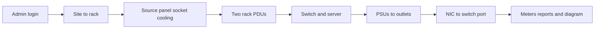

# Playwright Testing Strategy

Browser tests run entirely in Docker, against a second app instance and database. The demo on port 3000 is not the target. The suite is serial end-to-end UI coverage: create each entity, then cord and patch them, then check capacity and role limits.

## How it runs

A Compose profile `e2e` adds two services and leaves the existing `db` and `web` services alone.

- `web-e2e` reuses the app image with `DATABASE_URL` pointed at `racker_e2e` on the same Postgres. It is only on the Compose network (published on `3001` for debugging). Its existing entrypoint already pushes the schema and seeds when the database is empty.
- A one-shot `e2e-db-init` service creates `racker_e2e` if it does not exist. The current data volume was initialized before any second database, so an init script in `docker-entrypoint-initdb.d` would not run again.
- `e2e` is built from the official Playwright image, with `@playwright/test` installed in the image so browsers and `node_modules` never land on the host. Test files and `playwright.config.ts` are mounted in, and failure traces are written to `e2e/test-results`.

`web` and `web-e2e` get an HTTP healthcheck on `/login` so Playwright starts only after Next is actually serving.

Run with:

```bash
docker compose --profile e2e up -d --build web-e2e
docker compose --profile e2e run --rm e2e
```

Config: `baseURL` from `BASE_URL` (default `http://web-e2e:3000`), `workers: 1`, traces and screenshots retained on failure. One worker because every spec shares one database.

Reruns do not wipe data. Entity codes include a timestamp so unique fields (`Site.code`, user email) do not collide. Dropping only `racker_e2e` and restarting `web-e2e` reseeds. `docker compose down -v` also deletes the demo database, so that is not the reset path.

## What the suite covers

Two spec files. No component-unit tests and no pixel checks on React Flow.



**[e2e/lifecycle.spec.ts](e2e/lifecycle.spec.ts)** is `test.describe.serial`. One admin session creates a chain and asserts the result is visible before the next step.

- Hierarchy, via the admin modal in [src/app/(dashboard)/hierarchy/page.tsx](src/app/(dashboard)/hierarchy/page.tsx): site, building, floor, room, row, rack. Each step uses the button that already binds the parent (`New Site`, `+ Bldg`, `+ Floor`, `+ Room`, `+ Row`, `+ Rack`).
- Power and cooling, via the forms in [src/app/(dashboard)/power-cooling/page.tsx](src/app/(dashboard)/power-cooling/page.tsx): utility or UPS source on the new site, a panel in the new room, two floor whips (L1 and L2) aimed at the new rack, and a CRAH. Reassign one whip's phase and confirm the select sticks.
- Rack studio in [src/components/rack/RackElevationStudio.tsx](src/components/rack/RackElevationStudio.tsx): install an Arista switch and a Dell server from the catalog templates. Patch PSU 1 to a feed A C13 and PSU 2 to a feed B C13. Attach each PDU whip to the matching floor socket. In network mode, patch the server's first port to the switch's first port. A second device with a C20 plug clicked onto a C13 must show the incompatibility error and must not occupy the outlet.
- Proof: the outlet button name changes from `free` to the server name, the rack meter shows fewer free sockets and both feeds loaded, the reports page lists the new rack code, and the electrical diagram renders with the failure-simulation count.

**[e2e/rbac.spec.ts](e2e/rbac.spec.ts)** uses the seeded operator and a user created in the lifecycle.

- Operator login does not show `New Site` or `Users & RBAC Audit`.
- Operator can still open a seeded rack and the in-rack controls.
- `page.request` as the operator against `POST /api/hierarchy` and `POST /api/users` returns 403.
- Admin creates a user, changes the role, and the audit list shows `CREATE_USER`.

Locators are `getByRole`, `getByLabel`, and `getByPlaceholder`. The hierarchy modal labels and the outlet button names are already specific enough. Power inputs are placeholder-based today, which is sufficient for these forms.

## One UI gap the suite needs

A brand-new rack has no PDUs, and `ADD_RACK_PDU` exists only in [src/app/api/racks/operations/route.ts](src/app/api/racks/operations/route.ts). The lifecycle will add a small **Add PDU** control on the rack studio (name, feed A or B, mounting, optional floor socket) that posts that existing action. Without it, power cords on a rack created by the test cannot be made through the UI.

## Out of scope

Visual diff of the floor-plan heatmaps, dragging nodes on the diagram canvas, and load tests. CSV export can be asserted later with a download event; it is not required to prove the connections.