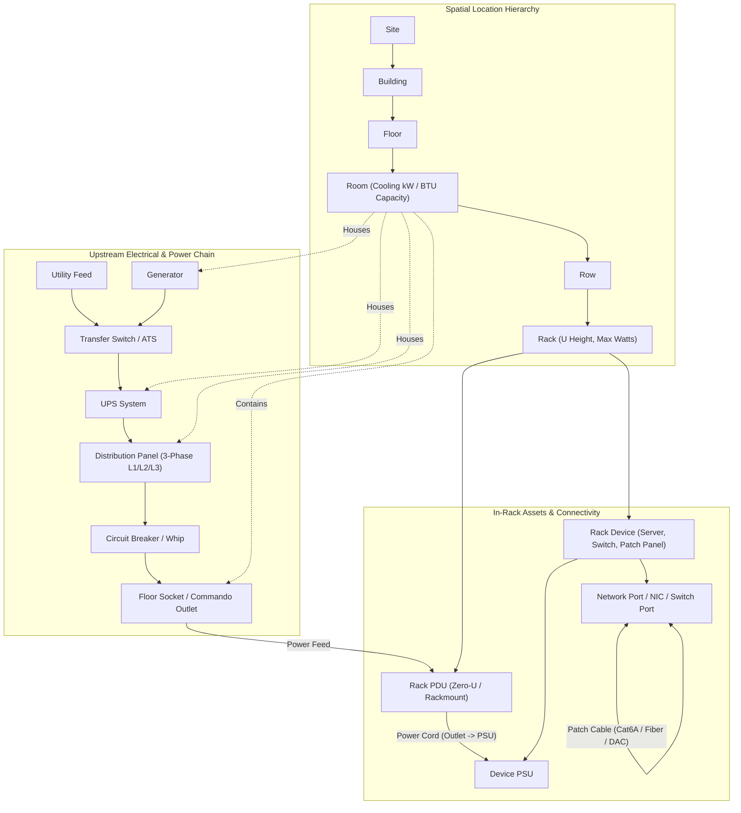

# Racker: Datacenter Infrastructure Management (DCIM) System Plan

## 1. Recommended Architecture & Technology Stack

To deliver a rich, interactive diagramming and rack-elevation UX alongside a deeply relational hierarchical and graph-like data model, we will use a unified TypeScript full-stack architecture:

- **Application Framework**: **Next.js (App Router, TypeScript)** in standalone output mode. Provides server-side data fetching, API routes / Server Actions with strict RBAC enforcement, and fast client interactivity.
- **Database & ORM**: **PostgreSQL 16** with **Prisma ORM**. PostgreSQL handles hierarchical queries, transactional cable/power patching, and aggregation rollups reliably, while Prisma provides end-to-end type safety.
- **Interactive Diagrams & Canvas UX**: **React Flow (`@xyflow/react`)** + **ELKjs (`elkjs`)** for automatic layered graph layout of single-line electrical diagrams, power chains, and network topologies, combined with custom SVG/Canvas interactive rack elevation and room floor-plan editors.
- **Drag-and-Drop & UI Components**: **`@dnd-kit/core`** for dragging devices into rack U-slots, **Tailwind CSS**, **shadcn/ui** (Radix Primitives), and **Lucide Icons** for a high-density, dark-mode-ready operator interface.
- **Charts & Capacity Analytics**: **Recharts** for phase balance, power load, cooling BTU/kW margins, and rack U fragmentation reports.
- **Authentication & RBAC**: **Auth.js (NextAuth v5)** or session-based JWT with **`bcryptjs`** password hashing, supporting `ADMIN` and `STANDARD` roles.
- **Deployment**: **Docker Compose** orchestrating the `db` (PostgreSQL with healthcheck), `migrate` / seed initialization, and `web` (Next.js standalone container).

---

## 2. System Architecture & Data Model

### Spatial Hierarchy & Power/Network Graph

### Core Database Schema (`[prisma/schema.prisma](prisma/schema.prisma)`)

- **Users & Auth**:
  - `User`: `id`, `email`, `name`, `passwordHash`, `role` (`ADMIN` | `STANDARD`), `createdAt`, `updatedAt`.
  - `AuditLog`: `id`, `userId`, `action`, `entityType`, `entityId`, `detailsJson`, `createdAt`.
- **Spatial Hierarchy**:
  - `Site`: `id`, `name`, `code`, `address`, `latitude`, `longitude`, ` utilityCapacityKw`.
  - `Building`: `id`, `siteId`, `name`, `code`.
  - `Floor`: `id`, `buildingId`, `name`, `levelNumber`.
  - `Room`: `id`, `floorId`, `name`, `roomType` (`DATA_HALL`, `POWER_ROOM`, `COOLING_PLANT`, `MEET_ME`), `coolingCapacityKw`, `coolingRedundancy` (`N`, `N_PLUS_1`, `TWO_N`), `ambientTempTargetC`, `widthMm`, `depthMm`, `gridCols`, `gridRows`.
  - `CoolingUnit`: `id`, `roomId`, `name`, `type` (`CRAC`, `CRAH`, `IN_ROW`, `CHILLER`), `capacityKw`, `status` (`ONLINE`, `STANDBY`, `MAINTENANCE`), `powerDrawWatts`.
  - `Row`: `id`, `roomId`, `name`, `orientation`, `aisleContainment` (`NONE`, `HOT_AISLE`, `COLD_AISLE`), `gridX`, `gridY`.
  - `Rack`: `id`, `rowId`, `name`, `totalU` (default 42 or 48), `maxWeightKg`, `maxPowerWatts`, `widthMm`, `depthMm`, `posX`, `posY`.
- **Upstream Power Infrastructure**:
  - `PowerSource`: `id`, `siteId`, `roomId`, `name`, `sourceType` (`UTILITY`, `GENERATOR`, `UPS`, `ATS`, `TRANSFORMER`), `capacityKw`, `voltageV`, `maxAmps`, `redundancyGroup` (`A`, `B`, `SHARED`), `fuelRuntimeHours`, `batteryRuntimeMins`, `upstreamSourceAId`, `upstreamSourceBId`.
  - `PowerPanel`: `id`, `roomId`, `upstreamSourceId`, `name`, `voltageLToN` (e.g., 230V), `voltageLToL` (e.g., 400V), `maxAmpsPerPhase`, `totalBreakerSlots`, `feedSide` (`A`, `B`).
  - `PowerCircuit` (Breaker / Floor Socket): `id`, `panelId`, `roomId`, `rackId`, `name`, `breakerNumber`, `phaseAllocation` (`L1`, `L2`, `L3`, `L1_L2`, `L2_L3`, `L3_L1`, `THREE_PHASE`), `ratedAmps`, `voltageV`, `socketType` (`IEC_C13`, `IEC_C19`, `IEC_60309_32A_1P`, `IEC_60309_32A_3P`, `IEC_60309_63A_3P`, `NEMA_L6_30R`), `floorSocketLabel`, `posX`, `posY`.
- **Rack PDUs & Sockets**:
  - `RackPdu`: `id`, `rackId`, `circuitId`, `name`, `model`, `mounting` (`ZERO_U_LEFT`, `ZERO_U_RIGHT`, `RACKMOUNT`), `startU`, `uHeight`, `feedSide` (`A`, `B`), `maxAmps`, `voltageV`, `maxWatts`, `inputPlugType`.
  - `PduOutlet`: `id`, `pduId`, `outletNumber`, `bankPhase` (`L1`, `L2`, `L3`), `socketType` (`C13`, `C19`, `NEMA_5_15R`), `maxAmps`.
- **Rack Devices, PSUs & Network Ports**:
  - `DeviceTemplate`: `id`, `manufacturer`, `model`, `deviceType` (`SERVER`, `SWITCH`, `ROUTER`, `FIREWALL`, `STORAGE`, `PATCH_PANEL`, `UPS_RACK`, `BLANKING_PANEL`), `uHeight`, `defaultWatts`, `heatShrinkFactor`, `psuCount`, `networkPortSpecJson`.
  - `RackDevice`: `id`, `rackId`, `templateId`, `name`, `hostname`, `assetTag`, `serialNumber`, `deviceType`, `startU`, `uHeight`, `face` (`FRONT`, `REAR`, `BOTH`), `status` (`ACTIVE`, `PROVISIONING`, `MAINTENANCE`, `DECOMMISSIONED`), `nominalWatts`, `peakWatts`, `weightKg`.
  - `DevicePsu`: `id`, `deviceId`, `name` (e.g., `PSU1`, `PSU2`), `maxWatts`, `plugType` (`C14`, `C20`), `connectedOutletId` (unique FK to `PduOutlet`), `cableColor`, `cableLabel`.
  - `NetworkPort`: `id`, `deviceId`, `name` (e.g., `eth0`, `eno1`, `Gi1/0/1`, `Port 24`), `portType` (`RJ45_1G`, `RJ45_10G`, `SFP_PLUS_10G`, `SFP28_25G`, `QSFP28_100G`, `FIBER_LC`, `CONSOLE`), `macAddress`, `ipAddress`, `vlanTag`, `isManagement`.
  - `NetworkCable`: `id`, `portAId` (unique), `portBId` (unique), `cableType` (`CAT6A`, `DAC`, `MMF_OM4`, `SMF_OS2`), `color`, `label`, `lengthMeters`.

---

## 3. Role-Based Access Control (RBAC) Matrix

Permission checks are enforced both in the UI (disabling/hiding admin controls) and on every API route / Server Action via `[src/lib/auth-guards.ts](src/lib/auth-guards.ts)`:

- **All Authenticated Users (`ADMIN` and `STANDARD`)**:
  - View the entire hierarchy (Sites, Buildings, Floors, Rooms, Rows, Racks).
  - View all upstream power infrastructure (Utility, Generators, UPS, Panels, Phases, Floor Sockets), cooling capacity, diagrams, and capacity reports.
  - Create, edit, move, and delete **in-rack assets**: `RackDevice` (servers, switches, patch panels), `RackPdu` placement, `DevicePsu` to `PduOutlet` power cords, `RackPdu` to `PowerCircuit` floor socket connections, and `NetworkCable` port-to-port patching.
- **Admin Users Only (`ADMIN`)**:
  - User management (`/admin/users`): create users, reset passwords, change roles (`ADMIN` / `STANDARD`), activate/deactivate accounts.
  - Facility & spatial structural management: create/update/delete `Site`, `Building`, `Floor`, `Room`, `Row`, `Rack` definitions.
  - Upstream facility power & cooling management: create/update/delete `PowerSource` (Generators, UPS, ATS, Utility), `PowerPanel`, `PowerCircuit` (breakers and floor sockets), `CoolingUnit`, and `DeviceTemplate` catalog items.

---

## 4. Interactive UX & Layered Visualizations

### A. Interactive Rack Elevation Studio (`[src/components/rack/RackElevationStudio.tsx](src/components/rack/RackElevationStudio.tsx)`)
- **Dual-Face U-Slot Grid**: Side-by-side Front and Rear 42U/48U elevation views with zero-U vertical PDU strips rendered on the left and right rails (color-coded for Feed A vs Feed B).
- **Drag-and-Drop Device Placement**: Drag device templates or existing devices into U slots with real-time collision detection (preventing overlapping U ranges).
- **Interactive Cable & Power Patching Canvas**:
  - **Power Mode**: Click or drag a wire from a Server/Switch `PSU` port directly to an available `PduOutlet` on the Zero-U / Rackmount PDU, and connect the PDU input whip to a room `FloorSocket`. SVG bezier cables render live with color coding (Feed A = Blue, Feed B = Red/Amber) and socket compatibility validation (e.g., warning if plugging a C20 cord into a C13 outlet).
  - **Network Mode**: Click a `NetworkPort` on a server and connect it to a switch port or patch panel port in the same rack or cross-rack via a port picker / interactive bezier overlay.

### B. Multi-Layer Visual Explorer (`[src/components/diagrams/LayeredVisualizer.tsx](src/components/diagrams/LayeredVisualizer.tsx)`)
A unified interactive canvas powered by `@xyflow/react` and custom SVG layers with layer toggles:
- **Layer 1: Spatial & Floor Plan View**: 2D grid of a Room showing Rows, Racks, Hot/Cold aisle containment, CRAC/CRAH cooling units, and Floor Sockets. Racks can be colored dynamically by **U Utilization %**, **Power Draw (kW)**, **Phase Imbalance**, or **Redundancy Status**.
- **Layer 2: End-to-End Electrical Single-Line Diagram (SLD)**: Interactive node-graph tracing from `Utility` / `Generator` -> `ATS` -> `UPS` -> `PowerPanel` (with live L1/L2/L3 phase load bars) -> `FloorSocket` -> `RackPdu` -> `DevicePsu`. Clicking any node highlights its entire upstream supply path and downstream blast radius ("Failure Simulation Mode": toggle a UPS, breaker, or PDU offline to see which devices lose redundancy or lose all power).
- **Layer 3: Network Topology Layer**: Interactive graph of Switches, Routers, Patch Panels, and Servers showing active links, speeds, and VLAN tags.
- **Layer 4: Thermal & Cooling Overlay**: Room-level heat production (Watts converted to BTU/hr and kW thermal load) compared against online and N+1 cooling capacity per room.

### C. Capacity Reporting & Live Indicators (`[src/app/(dashboard)/reports/page.tsx](src/app/(dashboard)/reports/page.tsx)`)
- **Rollup Calculation Engine (`[src/lib/capacity-engine.ts](src/lib/capacity-engine.ts)`)**:
  - **Rack U Capacity**: Used U, free U, largest contiguous free U block.
  - **PDU Capacity**: Used outlets vs free outlets (broken down by C13/C19), total Watts/Amps per PDU and per bank/phase (`L1`, `L2`, `L3`).
  - **Electrical Phase Balancing**: Exact Amps and Watts on `L1`, `L2`, and `L3` at every `PowerPanel` and 3-phase `PowerCircuit`, calculating phase imbalance percentage and flagging circuits over 80% NEC/IEC continuous load threshold.
  - **Upstream Supply & Cooling Margins**: Generator/UPS load percentage, estimated runtime, and Room thermal load (kW heat output vs active CRAC/CRAH cooling kW capacity).
  - **CSV / JSON Export**: Exportable audit and capacity tables for capacity planners.

---

## 5. Planned Directory & File Structure

- `[docker-compose.yml](docker-compose.yml)` - Multi-container setup (`postgres`, `racker-web`) with volume persistence and automatic schema push + seed on startup.
- `[Dockerfile](Dockerfile)` - Multi-stage Node 20 Alpine build for Next.js standalone deployment.
- `[prisma/schema.prisma](prisma/schema.prisma)` - Complete relational schema for spatial hierarchy, power chain, cooling, rack devices, PSUs, PDUs, and network ports.
- `[prisma/seed.ts](prisma/seed.ts)` - Rich realistic demo datacenter seed (2 Sites, Buildings, Data Halls, Generators, Dual A/B UPSes, 3-Phase Panels, Floor Sockets, 6 Racks, Zero-U PDUs, Switches, Servers, PSU cords, and Network cables, plus default `admin@racker.local` and `operator@racker.local` accounts).
- `[src/lib/db.ts](src/lib/db.ts)` - Prisma client singleton.
- `[src/lib/auth.ts](src/lib/auth.ts)` & `[src/lib/auth-guards.ts](src/lib/auth-guards.ts)` - Session management and RBAC enforcement (`requireAuth`, `requireAdmin`).
- `[src/lib/capacity-engine.ts](src/lib/capacity-engine.ts)` - Bottom-up aggregation of Watts, Amps per phase (L1/L2/L3), PDU sockets, Rack U usage, cooling load, and single-point-of-failure (SPOF) detection.
- `[src/app/(auth)/login/page.tsx](src/app/(auth)/login/page.tsx)` - Login page with quick-fill demo credentials indicator.
- `[src/app/(dashboard)/page.tsx](src/app/(dashboard)/page.tsx)` - Executive DCIM Dashboard with global KPI cards, alerts (phase imbalance, high PDU load, SPOF devices), and hierarchy tree explorer.
- `[src/app/(dashboard)/hierarchy/page.tsx](src/app/(dashboard)/hierarchy/page.tsx)` - Interactive hierarchical browser & Room Floor Plan editor (Sites -> Buildings -> Floors -> Rooms -> Rows -> Racks).
- `[src/app/(dashboard)/racks/[rackId]/page.tsx](src/app/(dashboard)/racks/[rackId]/page.tsx)` - Interactive Rack Elevation Studio (U-slot drag-and-drop, PSU-to-PDU interactive wiring, PDU-to-Floor-Socket connection, and Switch-to-Server network patching).
- `[src/app/(dashboard)/power-cooling/page.tsx](src/app/(dashboard)/power-cooling/page.tsx)` - Upstream Electrical & Cooling Manager (Generators, UPS, 3-Phase Panels, Breakers, Floor Sockets, CRAC units).
- `[src/app/(dashboard)/diagrams/page.tsx](src/app/(dashboard)/diagrams/page.tsx)` - Multi-layer interactive React Flow diagram (Power SLD with live failure simulator, Network topology, Spatial hierarchy, Cooling overlay).
- `[src/app/(dashboard)/reports/page.tsx](src/app/(dashboard)/reports/page.tsx)` - Comprehensive Capacity & Utilization Reports with visual gauges, phase balance charts, and CSV export.
- `[src/app/(dashboard)/admin/users/page.tsx](src/app/(dashboard)/admin/users/page.tsx)` - Admin-only User & Role Management console.
- `[src/app/api/](src/app/api/)` - REST/RPC endpoints for hierarchy CRUD, rack operations, power/network patching, user management, and real-time capacity calculation.
