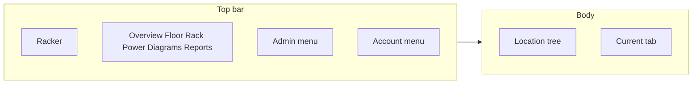

# Top tabs and a location tree

The current shell is a 256px sidebar of long page links plus a profile card ([src/components/layout/AppShell.tsx](src/components/layout/AppShell.tsx)). The only hierarchy is a second tree buried inside the floor-plan page ([src/app/(dashboard)/hierarchy/page.tsx](src/app/(dashboard)/hierarchy/page.tsx)), and it is always fully expanded. Rack clicks already leave for `/racks/[id]`. Room clicks only select a floor plan.

## Layout

- Sticky top bar, about 56px. Brand at the left. View tabs in the middle. Account at the right: name, role, email, sign out. The sidebar profile card goes away.
- Tab labels are short, with the current long names as tooltips: Overview, Floor, Rack, Power, Diagrams, Reports. Active tab uses the same cyan treatment the sidebar uses today.
- Admin is one menu, only for admins: System Management and Users & RBAC. Those two pages use the full width and do not show the tree. They are not spatial.
- Below `lg`, tabs scroll sideways and the tree is a drawer opened from a Locations button. On a desktop width the tree is a 280px column with its own scroll, and it can collapse to a thin rail. Open and collapsed state is remembered in `localStorage`.

## How the tree behaves

Depth stays Site, Building, Floor, Room, Row, Rack. A chevron expands or collapses and does not change the page. The name is the selection.

- Sites start collapsed, except the path to the room or rack you already have open. A huge hall should not dump every rack on first paint.
- A search box filters by name and code and opens the matching branches.
- Room rows stay buttons named with the room name. Rack rows stay links named with the rack code, pointing at `/racks/[id]`. Ancestor rows keep the visible admin actions `+ Bldg`, `+ Floor`, `+ Room`, and `+ Rack`, because [e2e/lifecycle.spec.ts](e2e/lifecycle.spec.ts) finds those controls by name and by nearby text such as `PW Hall (PB123)`.
- Creating a child expands that parent and keeps it open across the refresh.
- The floor page drops its inner tree column. The plan uses the full content width. New Site, Add Row, and Provision Rack stay in the floor page header, and the add modal stays there too.

Selection rules, so the tree does not yank you between tools at random:

- On Floor, a room click sets `?room=` and shows that plan. A rack click opens that rack in the Rack tab, which is what those links do today.
- On Rack, the open `/racks/[id]` is the highlighted leaf. A room click goes to Floor for that room, because an elevation needs one rack.
- On Overview, Power, Diagrams, and Reports, the tree is still the navigator: a room opens Floor, a rack opens Rack. Those pages stay estate-wide. Filtering their lists from the tree is a follow-up, not part of this layout change.
- The URL is the selection. Floor reads `room`. Rack reads the path id. Refresh and the highlighted tree node stay in agreement.

## Data

Add a small client provider in the dashboard shell that loads `GET /api/infrastructure` once and exposes `refresh`. The tree and the floor page both read it, so an add or a floor edit updates the tree without a second fetch. The floor page stops owning its own copy of that request.

The lifecycle spec’s XPath around `rounded-lg` will not match the new rows. Update that one test to use the same button names inside the tree, without changing what it creates.
