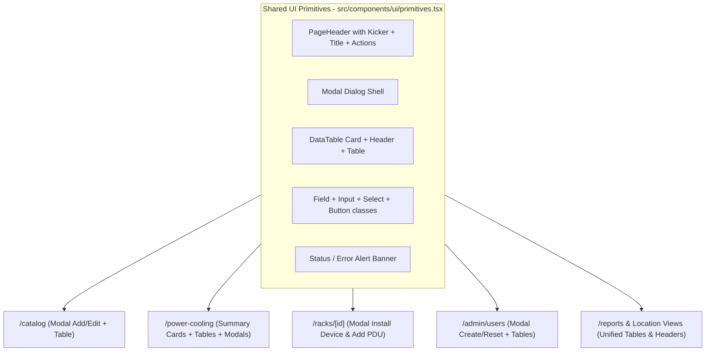

# UI/UX Consistency Plan

## Audit Summary

Across Racker, pages evolved with three different form patterns, four table styles, and mixed header/button conventions:

- **Forms**: Spatial entities (`SITE` through `RACK`) use centered modals in [`src/components/layout/infrastructure-context.tsx`](src/components/layout/infrastructure-context.tsx), Rack Studio uses inline collapsible drawers in [`src/components/rack/RackElevationStudio.tsx`](src/components/rack/RackElevationStudio.tsx), while Catalog ([`src/app/(dashboard)/catalog/page.tsx`](src/app/(dashboard)/catalog/page.tsx)), Power & Cooling ([`src/app/(dashboard)/power-cooling/page.tsx`](src/app/(dashboard)/power-cooling/page.tsx)), and Users ([`src/app/(dashboard)/admin/users/page.tsx`](src/app/(dashboard)/admin/users/page.tsx)) render permanently open forms—some with `<label>` wrappers and others with raw `placeholder`-only inputs.
- **Tables & Lists**: Overview, Catalog, Reports, Site, FloorPlan, and Users each style `<table>` headers, borders, and row padding slightly differently, while Power & Cooling and Reports render panels, floor whips, PDUs, and cooling units as ad-hoc `div` rows.
- **Page Headers & Controls**: Overview, Floor, Rack, Location pages, and System Management use an uppercase cyan kicker above the `h1`, while Catalog, Power & Cooling, Reports, Diagrams, and Users omit it. Primary buttons vary between `bg-cyan-500`, `bg-slate-800`, and `bg-amber-400`.
- **Light Theme Gaps**: [`src/app/globals.css`](src/app/globals.css) is missing light-mode text overrides for `select`/`input` elements that omit `text-white` (used in Power & Cooling and Users).

## 1. Shared UI Primitives

Create [`src/components/ui/primitives.tsx`](src/components/ui/primitives.tsx) so every page shares the same building blocks:

- **`Modal`**: Standardized backdrop (`fixed inset-0 z-50 flex items-center justify-center bg-black/70 p-4`), panel (`w-full rounded-xl border border-slate-700 bg-slate-900 p-6 shadow-2xl`), header with title and `Close` button, and footer bar (`border-t border-slate-800 pt-3 flex justify-end gap-2`).
- **`PageHeader`**: Standard `border-b border-slate-800 pb-5` header with optional breadcrumbs, uppercase cyan kicker (`text-xs font-semibold uppercase tracking-widest text-cyan-400`), `text-2xl font-bold text-white` title, `text-xs text-slate-400` subtitle, and right-aligned action slot.
- **`SectionCard` & `tableClasses`**: Rounded `rounded-xl border border-slate-800 bg-slate-900/80 overflow-hidden` wrapper, optional section header bar (`px-4 py-3 border-b border-slate-800 flex items-center justify-between`), and unified table header (`bg-slate-950/60 text-[11px] font-semibold uppercase tracking-wider text-slate-400`) and body (`divide-y divide-slate-800/80 text-xs`).
- **Form fields & buttons**: Shared `Field` label component (`block text-xs font-medium text-slate-300`), `inputClass` / `selectClass` (`mt-1 w-full rounded-lg border border-slate-700 bg-slate-950 px-3 py-2 text-xs text-white`), `btnPrimary` (`bg-cyan-500 hover:bg-cyan-400 text-slate-950 font-semibold`), `btnSecondary` (`border border-slate-700 bg-slate-900 hover:bg-slate-800 text-slate-200`), and `btnDanger` (`border border-rose-500/40 bg-rose-500/15 text-rose-200`).
- **`AlertBanner`**: Consistent `error` (rose) and `notice` (emerald) banners.

## 2. Convert All Create & Edit Forms to Modals

- **Appliance Catalog ([`src/app/(dashboard)/catalog/page.tsx`](src/app/(dashboard)/catalog/page.tsx))**:
  - Replace the permanently embedded top form with a `+ New appliance` primary button in the page header (alongside `Export CSV` and `Import CSV`).
  - Open the `Modal` for both creating (`New appliance`) and editing (`Edit appliance`), keeping the automatic watts-to-BTU calculation.
- **Rack Elevation Studio ([`src/components/rack/RackElevationStudio.tsx`](src/components/rack/RackElevationStudio.tsx))**:
  - Open `Install device` and `Add PDU` inside `Modal` dialogs instead of pushing the rack elevation canvas down the page.
  - Keep all existing field labels (`Catalog template`, `Name`, `Short Code`, `PDU name`, `Feed`, `Floor socket`) and button labels (`Place in rack`, `Add PDU`) so workflows and tests continue to work seamlessly.
- **Power Chain & Cooling ([`src/app/(dashboard)/power-cooling/page.tsx`](src/app/(dashboard)/power-cooling/page.tsx))**:
  - Replace the four inline forms (`Add a supply`, `Add panel`, `Add socket`, `Add unit`) with trigger buttons in the page/section headers (`+ Add supply`, `+ Add panel`, `+ Add socket`, `+ Add cooling unit`) that open labeled `Modal` forms.
  - Give every field a proper `<Field label="...">` instead of relying on placeholders alone.
- **Floor Plan Off-Plan Cooling & Grills ([`src/components/floor/FloorPlan.tsx`](src/components/floor/FloorPlan.tsx))**:
  - In `CoolingRegister` and `GrillRegister`, move `Add off-plan unit` and `Add grill` into modals triggered from the section header when editing layout, keeping `Resize room` as a compact toolbar control next to the 2D canvas.
- **Users & RBAC Audit ([`src/app/(dashboard)/admin/users/page.tsx`](src/app/(dashboard)/admin/users/page.tsx))**:
  - Replace the inline user creation bar with a `+ Create user` button in the page header that opens a `Create user` modal.
  - Replace the inline password input in each table row with a `Reset password` button that opens a focused modal for that user.
- **Spatial Hierarchy Modals ([`src/components/layout/infrastructure-context.tsx`](src/components/layout/infrastructure-context.tsx))**:
  - Refactor `HierarchyCreateDialog` and `HierarchyEditDialog` to use the shared `Modal`, `Field`, and button styles while preserving the exact heading `Add New ${type} to Infrastructure` and labels `Name / Description` and `Short Code`.

## 3. Unify Tables, Cards, and Page Headers

- **Power & Cooling ([`src/app/(dashboard)/power-cooling/page.tsx`](src/app/(dashboard)/power-cooling/page.tsx))**:
  - Keep the top **Power Sources** cards and **Room Thermal Envelope** summary cards (styled consistently with Overview cards).
  - Convert **Panels and phases**, **Floor sockets and breakers**, and **Cooling units** from stacked `div` rows into structured tables inside `SectionCard` containers with columns for specs, upstream/room links, and inline status/phase selectors.
- **Reports ([`src/app/(dashboard)/reports/page.tsx`](src/app/(dashboard)/reports/page.tsx))**:
  - Add the standard page kicker and `PageHeader` with secondary `Export CSV` buttons.
  - Convert **PDU sockets and amps** and **Upstream supply headroom** into clean tables matching the Rack capacity table, while keeping the visual 3-phase L1/L2/L3 load bars for Distribution panels and thermal progress bars for Room cooling.
- **Catalog, Users, Location Views, and Floor Plan Registers**:
  - Apply the unified table header, cell padding (`px-4 py-3`), hover state (`hover:bg-slate-800/40`), and section card wrapper across [`src/app/(dashboard)/catalog/page.tsx`](src/app/(dashboard)/catalog/page.tsx), [`src/app/(dashboard)/admin/users/page.tsx`](src/app/(dashboard)/admin/users/page.tsx), [`src/components/location/views.tsx`](src/components/location/views.tsx), and [`src/components/floor/FloorPlan.tsx`](src/components/floor/FloorPlan.tsx).
  - Convert the **Recent changes** audit log in [`src/app/(dashboard)/admin/users/page.tsx`](src/app/(dashboard)/admin/users/page.tsx) into a structured table (Action, Details, Operator, Timestamp).
- **Page Headers & Light Mode Polish**:
  - Add consistent kickers and `PageHeader` layout to Catalog (`Appliance Library & Specs`), Power & Cooling (`Facility Electrical & Thermal Plant`), Diagrams (`Single-Line & Topology Views`), Reports (`Telemetry & Capacity Audit`), and Users (`Directory & Access Control`).
  - Ensure all inputs and selects across dark and light themes have explicit contrast in [`src/app/globals.css`](src/app/globals.css).
  - Update [`e2e/lifecycle.spec.ts`](e2e/lifecycle.spec.ts) where it interacts with the Power & Cooling forms so it clicks the new modal trigger buttons before filling the fields, and update template names in the seed/test if needed.