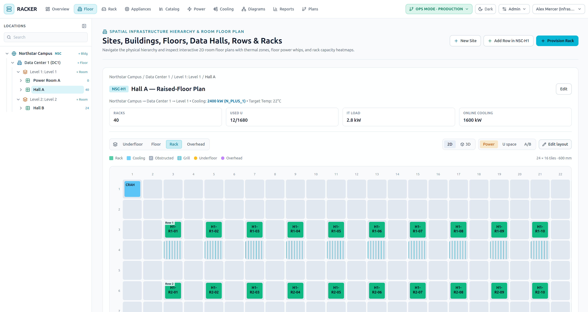

# Racker

Racker is a Datacenter Infrastructure Management (DCIM) web app for mapping facilities, racks, power, cooling, and in-rack gear — then rolling that inventory up into live capacity, thermal, and redundancy views.

It runs entirely in Docker. There is no host Node.js install to manage.



## What it covers

- **Spatial hierarchy** from site → building → floor → room → row → rack, with 2D and 3D floor plans
- **Rack studio** for U placement, PDUs, PSU cords, and network patching
- **Power chain** from utility / generator / UPS through 3-phase panels to floor sockets and rack PDUs
- **Cooling** units, thermal headroom, and N+1 style advisories
- **Catalog** of appliance and PDU templates, including CSV import/export
- **Capacity reports** for U space, kW, BTU/h, PDU outlets, phase balance, and single-corded devices
- **Ops Mode vs Plan Mode**: clone live production into an isolated plan, edit it, compare deltas, then apply back (admin only)
- **Local accounts** plus optional **OIDC / SSO**
- **RBAC**: Administrators edit the facility, power, cooling, users, and system data; Standard users view everything and edit in-rack devices

## Requirements

- [Docker Engine](https://docs.docker.com/engine/install/) with Docker Compose v2
- Ports **3000** free on the host (or change the published port in `docker-compose.yml`)
- About 2 GB of disk for the images and the Postgres volume

That is all. Schema apply, demo seed, and the Next.js server happen inside the `web` container.

## Fresh deployment

### 1. Get the source

```bash
git clone <your-racker-repo-url> racker
cd racker
```

### 2. Review secrets (recommended before first start)

The compose file ships with demo credentials so a laptop trial works immediately. For any shared or production host, edit `docker-compose.yml` **before** the first `up`:

| Setting | Where | What to change |
| --- | --- | --- |
| `AUTH_SECRET` | `web.environment` | Long random string used to sign session cookies. Changing it later signs everyone out. |
| `POSTGRES_USER` / `POSTGRES_PASSWORD` / `POSTGRES_DB` | `db.environment` | Postgres login. |
| `DATABASE_URL` | `web.environment` | Must match the Postgres user, password, database, and host `db`. |
| Published port | `web.ports` | `"3000:3000"` → `"8080:3000"` if 3000 is taken. |

Generate a session secret, for example:

```bash
openssl rand -hex 32
```

Paste that value into `AUTH_SECRET`. Keep `DATABASE_URL` in sync if you change the database password.

OIDC is optional and can be added later. See [Single sign-on](#single-sign-on-oidc).

### 3. Build and start

From the repository root:

```bash
docker compose up -d --build
```

The first run:

1. Builds the `racker-web` image (Prisma generate + Next.js production build)
2. Starts PostgreSQL 16 and waits until it is healthy
3. Applies the schema with `prisma db push`
4. Seeds a demo campus **only if the database has no users yet**
5. Serves the app on [http://localhost:3000](http://localhost:3000)

Watch startup until the web service is ready:

```bash
docker compose logs -f web
```

You should see schema sync, either a seed or `Database already seeded. Skipping...`, then `Ready`. Open [http://localhost:3000](http://localhost:3000) — unauthenticated visits redirect to `/login`.

### 4. Sign in

Demo accounts (created by the first-run seed):

| Role | Email | Password | Access |
| --- | --- | --- | --- |
| Administrator | `admin@racker.local` | `admin123` | Full facility, power, cooling, catalog, users, system, and **Apply plan to Ops** |
| Standard operator | `operator@racker.local` | `operator123` | View all infrastructure; edit devices, cords, and cables in racks. In **Plan Mode**, standard users can edit the whole plan. |

Change these passwords under **Admin → Users & RBAC Audit** before exposing the host.

The seed also loads a sample facility (London Docklands and Ashburn) with dual A/B power, CRAH/in-row cooling, racks, PDUs, and appliances so the overview, floor plans, and rack studio have data on day one.

### 5. Confirm a healthy stack

```bash
docker compose ps
```

Both `db` and `web` should be `healthy`. If `web` is still starting, wait for the `start_period` (about 20 seconds) plus schema apply.

## Day-to-day operations

**Rebuild after code changes**

```bash
docker compose up -d --build web
```

Do **not** add `-v`. The Postgres data lives in the `racker-pg` volume.

**Stop the stack, keep data**

```bash
docker compose down
```

**Wipe the database** (destroys the demo campus, users, and every plan schema):

```bash
docker compose down -v
```

Use that only when you want a true factory reset. The next `up` will seed again.

**Logs**

```bash
docker compose logs -f web
docker compose logs -f db
```

**Admin data tools** (signed in as an administrator): **Admin → System Management** can export/import a JSON snapshot, import CSV by entity, wipe infrastructure (users are kept), or provision an alternate demo scenario.

## Configuration reference

Compose reads host environment variables for OIDC (including a `.env` file next to `docker-compose.yml`). Database and session secrets are currently set directly on the services.

### Application

| Variable | Service | Default | Notes |
| --- | --- | --- | --- |
| `DATABASE_URL` | web | `postgresql://racker:racker@db:5432/racker?schema=public` | Prisma connection. `schema=public` is Ops Mode. |
| `AUTH_SECRET` | web | `racker-dcim-super-secret-jwt-key-2026` | JWT signing key. Required in production. |
| `POSTGRES_USER` | db | `racker` | |
| `POSTGRES_PASSWORD` | db | `racker` | |
| `POSTGRES_DB` | db | `racker` | |

### Single sign-on (OIDC)

SSO is **off** until `OIDC_CLIENT_ID` is set and either `OIDC_ISSUER_URL` or both `OIDC_AUTHORIZATION_ENDPOINT` and `OIDC_TOKEN_ENDPOINT` are set. Create a `.env` file in the repo root (Compose loads it automatically):

```bash
OIDC_ISSUER_URL=https://login.example.com/realms/datacenter
OIDC_CLIENT_ID=racker
OIDC_CLIENT_SECRET=replace-me
OIDC_REDIRECT_URI=https://racker.example.com/api/auth/oidc/callback
OIDC_PROVIDER_NAME=Company SSO
OIDC_SCOPES=openid profile email
OIDC_ROLE_CLAIM=groups
OIDC_ADMIN_GROUP=racker-admins
OIDC_DEFAULT_ROLE=STANDARD
```

Then recreate the web container so it picks up the values:

```bash
docker compose up -d web
```

| Variable | Default | Notes |
| --- | --- | --- |
| `OIDC_ISSUER_URL` | empty | Issuer; used for OIDC discovery (`/.well-known/openid-configuration`) |
| `OIDC_CLIENT_ID` | empty | Confidential client id |
| `OIDC_CLIENT_SECRET` | empty | Confidential client secret |
| `OIDC_REDIRECT_URI` | derived from the request host | Register this exact URI on the IdP. Typical: `https://<host>/api/auth/oidc/callback` |
| `OIDC_PROVIDER_NAME` | `Single Sign-On` | Label on the login button |
| `OIDC_SCOPES` | `openid profile email` | |
| `OIDC_ROLE_CLAIM` | `groups` | Claim inspected for admin membership |
| `OIDC_ADMIN_GROUP` | `racker-admins` | Value in that claim that grants `ADMIN` |
| `OIDC_DEFAULT_ROLE` | `STANDARD` | Role for new SSO users who are not in the admin group |
| `OIDC_AUTHORIZATION_ENDPOINT` | empty | Optional override if discovery is unavailable |
| `OIDC_TOKEN_ENDPOINT` | empty | Optional override |
| `OIDC_USERINFO_ENDPOINT` | empty | Optional override |
| `OIDC_JWKS_URI` | empty | Optional override |

Racker uses authorization-code + PKCE (S256). First successful SSO login auto-provisions a local user. Password login remains available.

Behind a reverse proxy, send `X-Forwarded-Proto` and `Host` (or `X-Forwarded-Host`) so the callback URL is correct when `OIDC_REDIRECT_URI` is left unset.

## Roles and workspace modes

- **Ops Mode** (default) is the production source of truth. Standard RBAC applies.
- **Plan Mode** clones Ops into an isolated Postgres schema. Activate a draft plan from the header pill or the **Plans** tab. Changes are visible only to sessions that have that plan active. Compare shows capacity deltas, warning diffs, and a change ledger. **Apply to Ops** is administrator-only and replaces live infrastructure (users and uploaded site/building media are kept).

## Putting it on a server

1. Point DNS at the host and terminate TLS on a reverse proxy (Caddy, nginx, Traefik) to `127.0.0.1:3000`.
2. Change `AUTH_SECRET` and Postgres passwords before the first start if this is not a throwaway VM.
3. If the public URL is not `http://localhost:3000`, set `OIDC_REDIRECT_URI` to `https://<public-host>/api/auth/oidc/callback` when using SSO.
4. Restrict port 3000 to localhost if the proxy is on the same machine.
5. Back up the Docker volume `racker-pg` on whatever cadence you need; that volume is the entire system of record.

Example Caddy snippet:

```caddy
racker.example.com {
  reverse_proxy 127.0.0.1:3000
}
```

## End-to-end tests (optional)

Playwright runs in Compose against a separate `racker_e2e` database so it does not touch the demo volume:

```bash
docker compose --profile e2e up --build --abort-on-container-exit e2e
```

## Stack

- Next.js 14 (App Router) + TypeScript
- PostgreSQL 16 + Prisma
- Tailwind CSS
- React Three Fiber (3D floor plans) and React Flow (diagrams)

## License

MIT